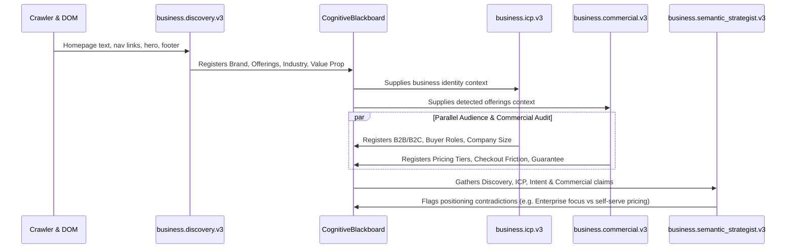
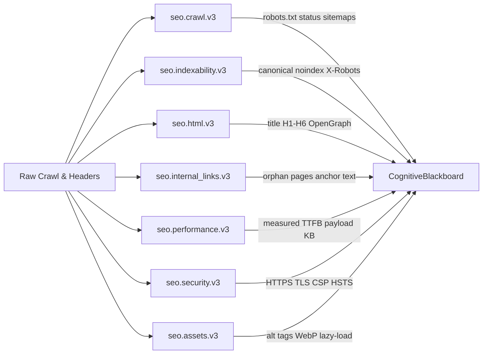
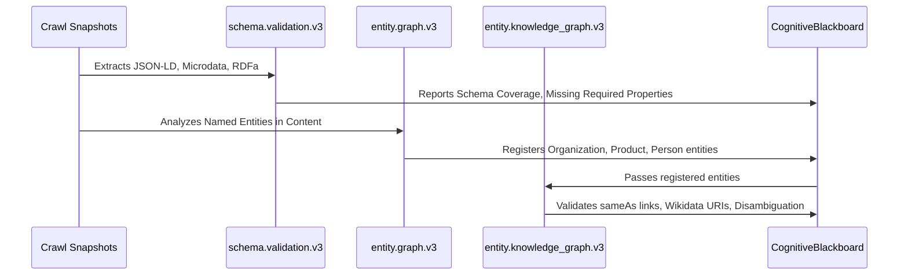
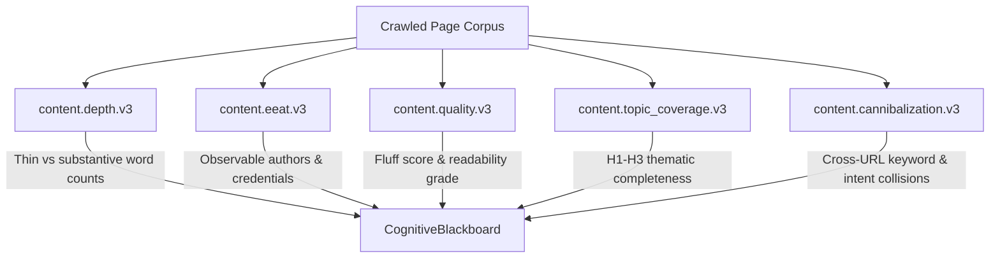
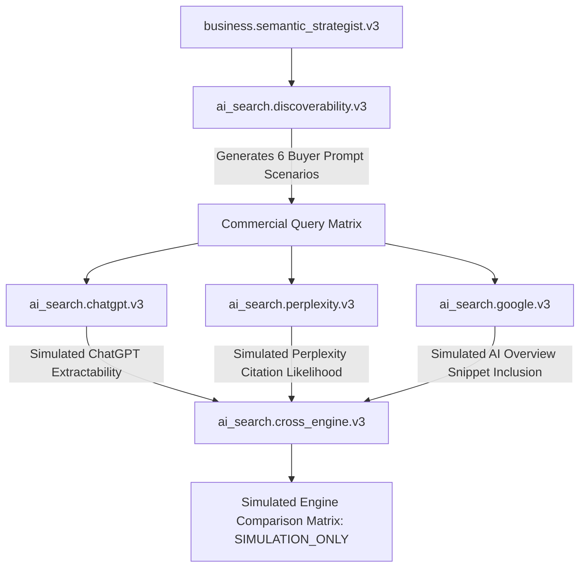
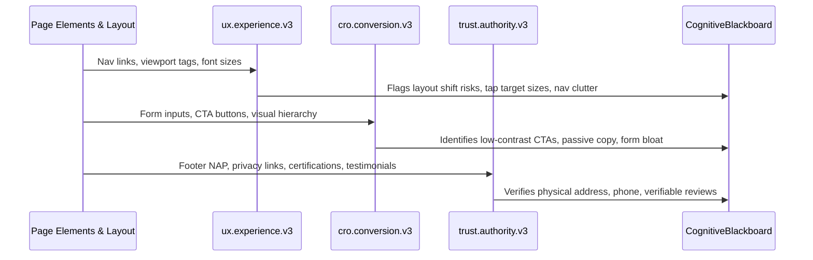
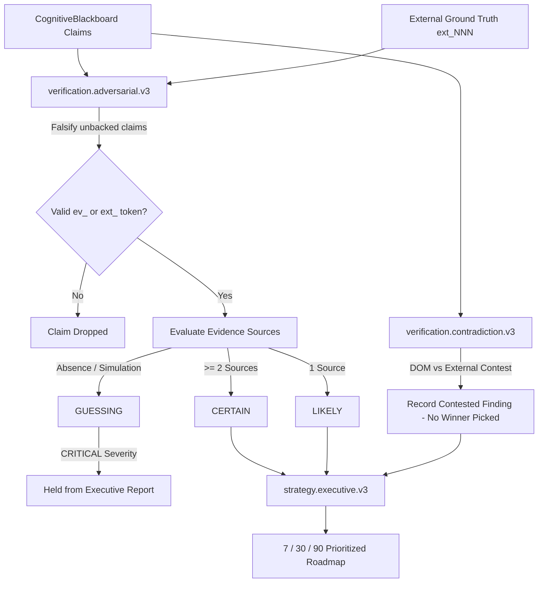
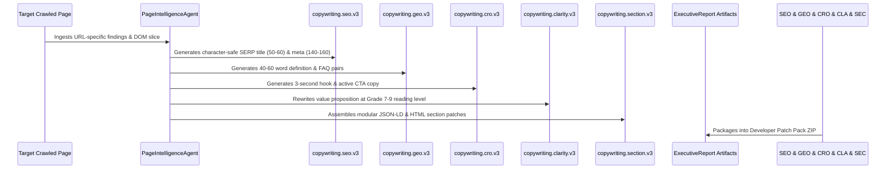

# Dristik AI — Enterprise Evidence-Driven Website Intelligence & Growth Auditor

[](https://fastapi.tiangolo.com)
[](https://reactjs.org/)
[](https://www.typescriptlang.org/)
[](https://www.python.org/)
[](https://tailwindcss.com/)
[](https://www.docker.com/)
[](#)

> **Core References:**
> - System Architecture, Features & 35-Agent Kahn DAG: [`AI_ARCHITECTURE_AND_AGENTS.md`](AI_ARCHITECTURE_AND_AGENTS.md)
> - Master Agent Catalog & System Prompts Directory: [`DRISTIK_AGENTS_AND_SYSTEM_PROMPTS.md`](DRISTIK_AGENTS_AND_SYSTEM_PROMPTS.md)
> - Product Map, Parameters, APIs & Integration Gaps: [`DRISTIK_PRODUCT_REPORT.md`](DRISTIK_PRODUCT_REPORT.md)

Dristik AI is an enterprise-grade autonomous website intelligence and growth audit platform. It treats Large and Small Language Models (LLMs/SLMs) not as unconstrained sources of truth, but as a replaceable inference engine operating strictly over a **Deterministic Evidence Plane**, an **Immutable Snapshot Store**, a **Typed Cognitive Blackboard**, an **Adversarial Verification Loop**, and a **Deterministic Scoring Engine**.

---

## 📑 Table of Contents

1. [Core Architecture & Execution Pipeline](#-core-architecture--execution-pipeline)
2. [Detailed Directory Structure](#-detailed-directory-structure)
   - [Root Layout](#root-repository-layout)
   - [Backend Architecture (`backend/app/`)](#backend-architecture-backendapp)
   - [Frontend Architecture (`frontend/src/`)](#frontend-architecture-frontend)
   - [Persistence, Tests & Deployment](#persistence-tests--deployment)
3. [Specialist Agent Workforce Catalog](#-specialist-agent-workforce-catalog)
   - [35-Agent Core DAG Workforce (8 Domains)](#the-35-core-dag-specialists)
   - [5 Page-Level Copywriting Agents](#the-5-page-level-copywriting-agents)
   - [Auxiliary System Orchestrators](#auxiliary-system-orchestrators)
4. [Agent Workflows by Section](#-agent-workflows-by-section)
   - [Global Kahn Wave DAG Flow](#0-global-kahn-wave-dag-execution-flow)
   - [Domain 1: Business Intelligence Workflow](#1-business-intelligence-workflow)
   - [Domain 2: Technical SEO & Infrastructure Workflow](#2-technical-seo--infrastructure-workflow)
   - [Domain 3: Structured Data & Entity Intelligence Workflow](#3-structured-data--entity-intelligence-workflow)
   - [Domain 4: Content Intelligence Workflow](#4-content-intelligence-workflow)
   - [Domain 5: Generative Engine Optimization (GEO) Workflow](#5-generative-engine-optimization-geo-workflow)
   - [Domain 6: AI Search & Engine Readiness Simulation Workflow](#6-ai-search--engine-readiness-simulation-workflow)
   - [Domain 7: UX, CRO & Trust Authority Workflow](#7-ux-cro--trust-authority-workflow)
   - [Domain 8: Adversarial Verification & Strategy Workflow](#8-adversarial-verification--strategy-workflow)
   - [Domain 9: Page Intelligence & Copywriting Workflow](#9-page-intelligence--copywriting-workflow)
5. [Complete Setup & Installation Guide](#-complete-setup--installation-guide)
   - [Prerequisites](#system-prerequisites)
   - [Automated Setup Scripts (`setup.sh`, `start.sh`, `run.sh`)](#automated-setup-and-launch)
   - [Manual Local Development Setup](#manual-local-development-setup)
   - [Docker Compose Deployment](#docker-compose-deployment)
   - [Verification, Tests & Health Check](#verification-tests--health-check)
6. [Multi-Provider LLM & Gateway Guide](#-multi-provider-llm--gateway-guide)
   - [Gateway Architecture & Safety Controls](#gateway-architecture--safety-controls)
   - [Supported LLM Providers & Configuration](#supported-llm-providers--configuration)
   - [Local Vector Embeddings Engine](#local-vector-embeddings-engine)
   - [Model Routing, Token Budgets & Cost Controls](#model-routing-token-budgets--cost-controls)
7. [Enterprise API Reference & Sealed Deliverables](#-enterprise-api-reference--sealed-deliverables)

---

## ⚡ Core Architecture & Execution Pipeline

```
Website URL
   │
   ▼
[Zero-Trust SSRF Guard] ──────────► Blocks private IPs, loopback, metadata services
   │
   ▼
[Multi-Page Crawl & Ingestion] ───► httpx + Playwright (thin SPA fallback) + robots.txt & sitemap
   │
   ▼
[10 Deterministic Analyzers] ─────► DOM, HTML, meta, schema, links, TTFB, security, trust ($0 LLM)
   │
   ▼
[Evidence Plane & Store] ─────────► ev_NNN (DOM observations) + ext_NNN (DNS/TLS/CrUX) + snap_<sha256>
   │
   ▼
[Wave-0 Site Facts & Identity] ───► BusinessUnderstandingOrchestrator: declared vs detected identity
   │
   ▼
[35-Agent Pool (6 Kahn Waves)] ──► Business, SEO, Schema, Content, GEO, AI Search, UX/CRO/Trust
   │
   ▼
[PageIntelligenceAgent] ──────────► Per-URL SEO audit + 5 Copywriting task cards
   │
   ▼
[Integrity Gate & Rubric] ────────► Ground truth binding; CERTAIN / LIKELY / GUESSING confidence
   │
   ▼
[Adversarial Verification Loop] ──► Falsifies unbacked claims; routes contests without bias
   │
   ▼
[Causal Engine & AI Simulator] ───► Root bottlenecks + 6 commercial question evaluations (SIMULATION_ONLY)
   │
   ▼
[Deterministic Scoring Engine] ───► Intent-adaptive 8 categories + Human, Google & AI readiness scores
   │
   ▼
[Remediation & Patch Generator] ──► Generates schema.jsonld, metadata.html, faq.html, llms.txt, robots.txt
   │
   ▼
[Cryptographic Seal: manifest] ───► Pins report UUID ↔ evidence ↔ snapshots ↔ agent call hashes
   │
   ▼
[Executive Delivery via SSE] ─────► Real-time telemetry, visual charts, WhatsApp 1-pager & ZIP download
```

---

## 📁 Detailed Directory Structure

### Root Repository Layout

```
dristik/
├── .env.example                 # Master environment template (multi-provider, ports, auth, crawling)
├── .dockerignore                # Docker ignore rules (caches, data, virtual environments)
├── .gitignore                   # Git ignore patterns
├── Dockerfile                   # Multi-stage production container definition (Python 3.11 + Playwright)
├── docker-compose.yml           # Unified container orchestrator for full-stack deployment
├── pyproject.toml               # Python build & packaging definitions
├── README.md                    # Primary operational manual and documentation (this document)
├── AI_ARCHITECTURE_AND_AGENTS.md# Technical architecture, execution DAG, and verification specifications
├── DRISTIK_AGENTS_AND_SYSTEM_PROMPTS.md # Complete catalog of specialist prompts and constitutions
├── DRISTIK_PRODUCT_REPORT.md    # Product report, parameter inventory, and endpoint audit
├── DRISTIK_WORKING_FLOW_AGENTS_GAPS.md # Operational workflows and audit gap analyses
├── setup.sh                     # Automated host setup: swap creation, Docker verification, .env init
├── start.sh                     # Production/dev launch orchestrator with live log streaming
├── run.sh                       # Quick launcher shortcut forwarding to start.sh
├── redeploy.sh                  # Automated container rebuild and zero-downtime deployment script
├── create_admin_docker.sh       # Script to generate initial admin credentials inside Docker
├── update_citation_models.sh    # Script to sync live AI search models and citation parameters
├── alienhouse_5pages.json       # Canonical reference audit fixture for regression testing
├── prompts/                     # Architectural governance prompts & agent specification templates
│   ├── constitution.md          # Master agent constitution enforcing ground-truth rules
│   ├── orchestrator.md          # Mission director & pipeline orchestrator prompt
│   ├── synthesizer.md           # Executive synthesis and remediation prompt
│   ├── verifier.md              # Adversarial verification agent prompt
│   └── agent_template.yaml      # Canonical specification template for specialist agents
├── scripts/                     # Production utility, maintenance, and verification scripts
├── deployment/                  # Production deployment artifacts, Nginx configs, and systemd units
├── data/                        # Persistent storage: SQLite databases, run records, and snapshots
├── backend/                     # FastAPI core backend application
└── frontend/                    # Vite + React 19 + TypeScript frontend application
```

### Backend Architecture (`backend/app/`)

```
backend/app/
├── main.py                      # FastAPI application factory, middleware, CORS, lifespan, /health
├── logging_config.py            # Structured logging configuration with log rotation
├── agents.py                    # Compatibility re-export module routing to orchestration runtime
├── analyzers.py                 # Core analyzer entrypoints
├── audit.py                     # Audit lifecycle and runner interfaces
├── capabilities.py              # System capabilities registry and validation
├── evidence.py                  # Evidence schemas and helper interfaces
├── inference.py                 # Gateway compatibility shim for app.core.inference
├── integrations.py              # External connector integrations re-export
├── intelligence.py              # Domain intelligence pipelines re-export
├── notifications.py             # Event notification interfaces
├── payments.py                  # Razorpay payment models and webhook validators
├── persistence.py               # Repository interfaces and SQLite persistence
├── pillars.py                   # 5-Pillar aggregation models (SEO, GEO, CRO, AI, Foundation)
├── tasks.py                     # Background task handlers
├── tenancy.py                   # Multi-tenant context and workspace scoping
├── verification.py              # Verification status and integrity types
│
├── api/                         # REST & SSE API Gateway
│   ├── router.py                # Master router mounting all endpoints under /api/v1 and /api
│   └── routes/                  # Modular route controllers
│       ├── audits/              # POST /analyses (create), GET /analyses/{id}/stream (SSE)
│       ├── identity/            # Auth, sessions, RBAC, organization management
│       ├── platform/            # System status, contact, metadata, workspace settings
│       ├── intelligence/        # Strategic insights, GEO analytics, Radar pulses, outcomes
│       ├── integrations/        # Connectors: Google Search Console, GA4, DataForSEO
│       └── remediation/         # Code patch approvals, manual application, ZIP downloads
│
├── core/                        # Core Infrastructure & Cross-Cutting Concerns
│   ├── config.py                # Pydantic Settings, multi-provider credentials, model overrides
│   ├── security/                # Zero-Trust SSRF protection, trust boundaries, audit logger
│   │   ├── ssrf.py              # IP blacklisting, DNS rebinding guard, private range blocks
│   │   └── trust_boundary.py    # Cross-tenant and data isolation guards
│   ├── privacy/                 # Data privacy & redaction
│   │   └── sanitizer.py         # PII detection, token scrubbing, prompt injection defense
│   ├── policy/                  # Policy pack engine
│   │   └── engine.py            # Budget policies, audit tier restrictions, safety checks
│   └── inference/               # Unified Multi-Provider LLM Gateway
│       ├── llm_client.py        # Async HTTP client, TokenBucketRateLimiter, jitter backoff
│       ├── model_router.py      # Task-to-model router (fast_slm vs reasoning_model)
│       ├── pricing.py           # Per-token cost calculation and billing ledger
│       ├── budget_manager.py    # Per-audit token budget tracking and threshold alerting
│       ├── fallback.py          # Provider cascading logic (Groq -> Together -> OpenRouter)
│       ├── json_repair.py       # Robust JSON extraction and AST repair for dirty LLM outputs
│       ├── prompt_compiler.py   # System prompt compilation with evidence injection
│       └── telemetry.py         # Cost, latency, and token consumption tracking
│
├── orchestration/               # Multi-Agent Pipeline & DAG Execution Engine
│   ├── orchestrator.py          # AnalysisOrchestrator: 36-step pipeline coordinator
│   ├── agent_pool.py            # AgentPool: Kahn topological wave executor (6 waves)
│   ├── integrity_gate.py        # Post-DAG integrity verification & dangling token purge
│   ├── planner.py               # Dynamic capability planner and execution selector
│   ├── dag.py                   # Dependency graph representation
│   └── runtime/                 # Agent Runtime Subsystem
│       ├── base_agent.py        # Abstract base agent interface
│       ├── specialist.py        # SpecialistAgent: Runtime class powering all 35 DAG specialists
│       ├── registry.py          # Typed definitions for all 35 agents (models, budgets, deps)
│       ├── task_cards.py        # Task card instructions and evidence requirements per agent
│       ├── execution_context.py # Per-agent execution state and blackboard isolation
│       └── reasoner.py          # Structured reasoning helpers and claim generation
│
├── crawl/                       # Ingestion & Deterministic Analysis Subsystem
│   ├── crawler.py               # CrawlerService: Multi-page crawler with priority scoring
│   ├── browser.py               # Playwright headless browser wrapper for SPA rendering
│   ├── sitemap.py               # XML sitemap parser with discovery extraction
│   ├── embeddings.py            # Local Hugging Face / remote embeddings client
│   ├── vector_store.py          # Vector store for semantic page search
│   ├── discovery/               # Pre-crawl discovery analyzers
│   │   ├── business_discovery.py# Initial business entity detection
│   │   ├── product_discovery.py # Catalog and product page discovery
│   │   └── brand_discovery.py   # Brand and trademark identifier
│   ├── page_intelligence/       # PageIntelligenceAgent: per-URL SEO and copywriting runner
│   └── analyzers/               # 10 Deterministic Analyzers ($0 LLM Token Cost)
│       ├── html.py              # Semantic landmarks, headings (H1-H6), DOM depth
│       ├── visible.py           # Boilerplate stripper, word counts, content density
│       ├── meta.py              # Title, meta description, OpenGraph, Twitter Cards
│       ├── dom.py               # Element accessibility, button vs anchor correctness
│       ├── schema.py            # JSON-LD, Microdata, RDFa structure and syntax parsing
│       ├── links.py             # Link graph builder: internal, external, orphan detection
│       ├── performance.py       # Measured TTFB, total payload size, asset distribution
│       ├── security.py          # TLS/SSL version, CSP, HSTS, X-Frame-Options, CORS
│       ├── trust_signals.py     # Privacy policy, terms, contact NAP, security badges
│       └── dynamic_content.py   # Client-side hydration detection and JS framework markers
│
├── evidence/                    # Evidence Plane & Ground Truth
│   ├── store.py                 # EvidenceStore: ev_NNN token registry with SHA-256 validation
│   ├── graph.py                 # EvidenceGraph: Bi-directional network of pages, claims, facts
│   ├── retriever.py             # Token-bounded evidence slice retriever (limit 30 per agent)
│   ├── site_facts.py            # Wave-0 deterministic fact extractor
│   ├── enrichment.py            # ExternalEvidenceEnricher: ext_NNN (DNS, TLS, CrUX)
│   └── validation.py            # Cryptographic token format and integrity validator
│
├── cognition/                   # Cognitive Reasoning & Blackboard System
│   ├── blackboard.py            # CognitiveBlackboard: Shared state across all waves
│   ├── claims.py                # Typed claims (PROVISIONAL -> VERIFIED / CONTESTED)
│   ├── ground_truth.py          # Ground-truth binding against ev_ and ext_ tokens
│   ├── finding_rubric.py        # CERTAIN, LIKELY, GUESSING confidence rubric
│   ├── confidence.py            # Decoupled confidence and evidence coverage calculations
│   ├── contradiction.py         # Contradiction detection and neutral contest routing
│   ├── consensus.py             # Cross-agent consensus evaluators
│   ├── hypotheses.py            # Pre-audit hypothesis generation and post-audit evaluation
│   ├── causal.py                # CausalReasoningEngine: Primary bottleneck identification
│   └── decision_engine.py       # Synthesizes blackboard claims into final Finding entities
│
├── intelligence/                # Specialized Intelligence Domains
│   ├── business/                # BusinessUnderstandingOrchestrator: declared vs detected identity
│   ├── geo/                     # Generative Engine Optimization readiness & buyer question engine
│   ├── aeo/                     # Answer Engine Optimization and direct-answer analysis
│   ├── competitive/             # Competitor discovery, bake-offs, and parity benchmarking
│   ├── citations/               # AI Citation tracker and on-page simulation
│   ├── outcomes/                # OutcomeStore: 30/60/90-day tracking and automated rechecks
│   └── monitoring/              # Radar pulse continuous website monitoring
│
├── audit/                       # Cryptographic Sealing & Verification
│   ├── snapshots.py             # SnapshotStore: Content-addressed store (snap_<sha256>)
│   ├── manifest.py              # build_run_manifest & seal_manifest (manifest.json)
│   ├── ledger.py                # Cryptographic hash-chained audit ledger
│   └── regression_engine.py     # Run-to-run regression and drift detection
│
├── remediation/                 # Automated Patch & Fix Generator
│   ├── planner.py               # RemediationPlanner: Prioritizes actionable code fixes
│   ├── patches.py               # Generates schema.jsonld, metadata.html, robots.txt, etc.
│   ├── validator.py             # Syntax and validity check for generated patches
│   └── sync_engine.py           # CMS connector sync engine (WordPress, Webflow, Shopify)
│
├── reports/                     # Report Synthesis & Formatting
│   ├── narrative.py             # Executive narrative and business story synthesizer
│   ├── roadmap.py               # RoadmapBuilder: 7 / 30 / 90-day prioritized action plan
│   ├── pdf.py                   # High-fidelity PDF generation pipeline
│   └── deck.py                  # Presentation deck generation
│
├── scoring/                     # Scoring Subsystem
│   ├── engine.py                # ScoringEngine: Intent-adaptive 8-category scoring
│   ├── weights.py               # Category weightings based on detected site business model
│   └── scoring_rubric.py        # Transparent deduction and grading rules
│
├── connectors/                  # External CMS & Platform Connectors
│   ├── base.py                  # Abstract connector interface
│   ├── store.py                 # Encrypted connector credential store
│   └── providers/               # GitHub, WordPress, Shopify, Webflow, Google Search Console
│
├── identity/                    # Enterprise Auth & Security
│   ├── store.py                 # SQLite user, session, and API key storage
│   ├── service.py               # Authentication and token issuance service
│   ├── security.py              # Argon2 password hashing and JWT token signing
│   ├── authorizer.py            # Role-Based Access Control (RBAC) middleware
│   └── sso_scim.py              # Enterprise SAML/SSO and SCIM provisioning
│
├── db/                          # Database Connections & Schemas
├── domain/                      # Typed Domain Models, Enums, and Provenance records
├── workers/                     # Cognitive workers (AI search simulator, synthesizer)
└── notifications/               # Email and webhook alert dispatchers
```

### Frontend Architecture (`frontend/`)

```
frontend/
├── package.json                 # React 19, Vite, Lucide icons, Tailwind dependencies
├── tsconfig.json                # TypeScript compiler configuration
├── vite.config.ts               # Vite bundler configuration with backend proxy
├── src/
│   ├── main.tsx                 # Application mount point
│   ├── App.tsx                  # Master routing, theme provider, and view orchestrator
│   ├── index.css                # Global styles, Tailwind base, and dark mode variables
│   ├── types.ts                 # Typed schemas matching backend ExecutiveReport & models
│   │
│   ├── components/              # User Interface Components
│   │   ├── Navigation/          # TopBar, Sidebar, RecentAuditsDropdown, Breadcrumbs
│   │   ├── Pillars/             # PillarDetailView: Technical, Content, GEO, CRO, Foundation
│   │   ├── VisualIntelligence/  # Radar charts, funnel visualizers, engine comparison graphs
│   │   ├── findings/            # Findings table, filter bars, evidence badges, severity chips
│   │   ├── evidence/            # EvidenceDrawer: Content-addressed snapshots & token viewer
│   │   ├── ui/                  # Reusable UI primitives: Buttons, Cards, Modals, Tabs, Tooltips
│   │   ├── charts/              # Recharts / SVG chart primitives
│   │   │
│   │   ├── LiveExecutionConsole.tsx # Real-time SSE execution telemetry and agent status
│   │   ├── Big4AuditReport.tsx  # Executive Big-4 audit presentation view
│   │   ├── AuditForm.tsx        # Audit initiation form (URL, crawl tier, site type)
│   │   ├── DynamicQuestionSandboxView.tsx # Interactive buyer question simulation view
│   │   ├── RealAiCitationTracker.tsx # Simulated vs live ChatGPT/Perplexity citation matrix
│   │   ├── DeveloperPatchPackModal.tsx # Patch pack ZIP inspector and code copy drawer
│   │   ├── ConnectorsModal.tsx  # Google Search Console, GA4, WordPress, Shopify connectors
│   │   ├── ScoringRubricModal.tsx # Transparent category deduction and weighting breakdown
│   │   ├── WhatsAppShareButton.tsx # One-click C-suite WhatsApp executive brief formatter
│   │   ├── GstInvoiceModal.tsx  # Compliant commercial tax invoicing
│   │   ├── AccountPanel.tsx     # User settings, API keys, and workspace management
│   │   └── PublicGrader.tsx     # Public lightweight website grading portal
│   │
│   ├── report/                  # Report transformation, formatting, and data structures
│   ├── services/                # Axios / fetch API clients, SSE stream subscribers
│   ├── lib/                     # Client utilities, date formatters, export helpers
│   ├── routes/                  # View definitions and page controllers
│   ├── layouts/                 # Master shell layouts
│   ├── design/                  # Design tokens, color palettes, and typography rules
│   └── styles/                  # Custom CSS animations and overrides
```

### Persistence, Tests & Deployment

```
dristik/
├── data/                        # Persistent Storage
│   ├── dristik.db               # SQLite application database (users, audits, workspaces)
│   ├── geo_aeo_pipeline.db      # GEO/AEO benchmarks, prompt matrices, simulation cache
│   ├── external_authority.db    # Third-party connector caches and token store
│   └── runs/                    # Content-addressed snapshot storage per analysis UUID
│       └── <analysis_id>/
│           ├── snapshots/       # Raw crawl bodies (snap_<content_sha256>)
│           ├── manifest.json    # Cryptographic run manifest with token pins
│           └── report.json      # Full sealed ExecutiveReport artifact
│
├── backend/tests/               # Comprehensive Pytest Suite
│   ├── test_pipeline.py         # Full end-to-end audit execution pipeline
│   ├── test_agent_pool_35.py    # Enforces exactly 35 agents with valid Kahn wave ordering
│   ├── test_zero_fake_data_and_fail_closed.py # Enforces zero hallucinated vanity metrics
│   ├── test_finding_rubric.py   # CERTAIN / LIKELY / GUESSING rubric tests
│   ├── test_ground_truth_v4.py  # ev_ and ext_ evidence grounding enforcement
│   ├── test_geo_readiness.py    # Answer extractability and buyer question evaluations
│   ├── test_ssrf_egress.py      # SSRF guard validation against private IPs/AWS metadata
│   ├── test_auth_rbac.py        # RBAC and session security tests
│   ├── test_copywriting_specialists.py # 5 copywriting agents validation
│   └── test_reproducibility.py  # Validates deterministic scoring given identical evidence
│
└── deployment/                  # Production Infrastructure Configurations
    ├── nginx.conf               # Reverse proxy config with SSE streaming support
    ├── dristik.service          # Systemd service unit for backend gateway
    └── dristik-frontend.service # Systemd service unit for frontend web server
```

---

## 🤖 Specialist Agent Workforce Catalog

Dristik AI executes a workforce of **35 canonical specialist agents** organized inside the topological DAG, plus **5 page-level copywriting specialists** executing inside the Page Intelligence stage, and 5 dedicated system orchestrators.

### The 35 Core DAG Specialists

| Domain | Agent ID | Agent Name | Mode | Dependencies | Budget | Primary Purpose |
|:---|:---|:---|:---:|:---|:---:|:---|
| **Business** | `business.discovery.v3` | Business Discovery | LLM | *None* | 4000 | Identifies legal/brand name, offerings, industry, business model, and value prop. |
| **Business** | `business.icp.v3` | ICP Intelligence | LLM | `business.discovery.v3` | 4000 | Classifies ideal customer profile, B2B/B2C, company size, and buyer roles. Gated (ICP). |
| **Business** | `business.intent.v3` | Search Intent | LLM | `business.discovery.v3` | 3500 | Maps visitor intent: Informational, Commercial, Transactional, Navigational, Comparison. |
| **Business** | `business.commercial.v3` | Commercial Intelligence | LLM | `business.discovery.v3` | 4500 | Analyzes pricing models, tiers, packaging, and checkout friction. Gated (PRICING). |
| **Business** | `business.semantic_strategist.v3` | Semantic Strategist | LLM | `discovery`, `icp`, `intent`, `commercial` | 6000 | Arbitrates positioning conflicts (e.g., enterprise pitch with self-serve pricing). |
| **Technical SEO** | `seo.crawl.v3` | Crawl Intelligence | **DET** | *None* | 2500 | Analyzes robots.txt directives, XML sitemaps, status codes, crawl depth, and redirects. |
| **Technical SEO** | `seo.indexability.v3` | Indexability | **HYBRID** | *None* | 3500 | Evaluates canonical consistency, noindex headers, and robots meta tags. |
| **Technical SEO** | `seo.html.v3` | Technical HTML | **DET** | *None* | 3000 | Validates title, meta description, H1–H6 hierarchy, and HTML5 landmark structure. |
| **Technical SEO** | `seo.internal_links.v3` | Internal Links | **HYBRID** | *None* | 3500 | Maps internal link graph, detects orphan pages, and flags uninformative anchor text. |
| **Technical SEO** | `seo.performance.v3` | Performance | **DET** | *None* | 3000 | Evaluates measured TTFB and payload sizes. Never invents field Core Web Vitals. |
| **Technical SEO** | `seo.security.v3` | Security SEO | **DET** | *None* | 2500 | Inspects HTTPS, HSTS, CSP, X-Frame-Options, and TLS certificates. |
| **Technical SEO** | `seo.assets.v3` | Media & Assets | **HYBRID** | *None* | 3000 | Checks image alt text, modern formats (WebP/AVIF), dimension tags, and lazy loading. |
| **Structured Data**| `schema.validation.v3` | Schema Intelligence | **HYBRID** | *None* | 4000 | Parses and validates JSON-LD / Microdata schemas against Schema.org standards. |
| **Structured Data**| `entity.graph.v3` | Entity Intelligence | LLM | *None* | 4000 | Extracts core entities (Organization, Product, Service, Person, Place). |
| **Structured Data**| `entity.knowledge_graph.v3` | Knowledge Graph | LLM | `entity.graph.v3` | 4500 | Verifies `sameAs` authority links, Wikidata entries, and entity disambiguation. |
| **Content** | `content.depth.v3` | Content Depth | LLM | *None* | 4000 | Measures substantive vs thin content, word counts, and topical completeness. |
| **Content** | `content.eeat.v3` | E-E-A-T Intelligence | LLM | *None* | 4500 | Inspects observable author credentials, expertise, and citations. Gated (AUTHORSHIP). |
| **Content** | `content.quality.v3` | Content Quality | LLM | *None* | 4000 | Flags corporate buzzword fluff (`cutting-edge`, `seamless`, etc.) and clarity issues. |
| **Content** | `content.topic_coverage.v3` | Topic Coverage | LLM | *None* | 4000 | Evaluates topical hierarchy across headings and identifies thematic gaps. |
| **Content** | `content.cannibalization.v3`| Cannibalization | LLM | *None* | 4000 | Identifies competing URLs targeting identical keywords and search intents. |
| **GEO** | `geo.extractability.v3` | Answer Extractability | LLM | *None* | 4500 | Identifies 40–60 word answer-first definitions, structured tables, and FAQ blocks. |
| **GEO** | `geo.information_gain.v3` | Information Gain | LLM | *None* | 4500 | Measures proprietary data, primary research, and original methodology vs rehashed copy. |
| **GEO** | `geo.citation_readiness.v3`| Citation Readiness | LLM | `strategist`, `entity.graph`, `content.quality` | 5000 | Maps claims to verifiable proof points required for AI engine citations. |
| **GEO** | `geo.structure.v3` | Generative Structure | LLM | *None* | 4000 | Evaluates answer-first layout, executive summaries, and schema alignment for LLMs. |
| **AI Search** | `ai_search.discoverability.v3` | AI Discoverability | LLM | `business.semantic_strategist.v3` | 4500 | Synthesizes synthetic commercial buyer prompt matrices for AI search simulations. |
| **AI Search** | `ai_search.chatgpt.v3` | ChatGPT Visibility | LLM | `ai_search.discoverability.v3` | 4000 | Simulates ChatGPT answerability from DOM. Labeled `SIMULATION_ONLY`. |
| **AI Search** | `ai_search.perplexity.v3` | Perplexity Visibility | LLM | `ai_search.discoverability.v3` | 4000 | Evaluates citation eligibility and source attribution. Labeled `SIMULATION_ONLY`. |
| **AI Search** | `ai_search.google.v3` | Google AI Search | LLM | `ai_search.discoverability.v3` | 4000 | Simulates Google AI Overview and featured snippet readiness from structured evidence. |
| **AI Search** | `ai_search.cross_engine.v3` | Cross-Engine | LLM | `chatgpt`, `perplexity`, `google` | 4500 | Synthesizes simulated visibility and answer consistency across all AI engines. |
| **UX & CRO** | `ux.experience.v3` | UX Intelligence | **HYBRID** | *None* | 3500 | Assesses layout hierarchy, navigation friction, readability, and mobile responsiveness. |
| **UX & CRO** | `cro.conversion.v3` | Conversion Intelligence | LLM | *None* | 4000 | Analyzes call-to-action copy, CTA contrast, form fields, and conversion paths. |
| **UX & CRO** | `trust.authority.v3` | Trust Authority | LLM | *None* | 4000 | Verifies testimonials, physical address, phone, privacy policy, and client logos. Gated (TRUST). |
| **Verification** | `verification.adversarial.v3` | Adversarial Verification | **HYBRID** | `icp`, `commercial`, `eeat`, `trust` | 5000 | Falsifies unbacked claims; downgrades ungrounded findings; holds GUESSING+CRITICAL. |
| **Verification** | `verification.contradiction.v3`| Contradiction & Causal | **HYBRID** | `adversarial`, `icp`, `commercial`, `performance`, `eeat`, `trust` | 5000 | Resolves conflicting claims between DOM and external ground truth without bias. |
| **Strategy** | `strategy.executive.v3` | Executive Intelligence | LLM | `verification.contradiction.v3` | 6000 | Synthesizes C-suite findings, prioritized 7/30/90-day roadmap, and business impact. |

> **Execution Modes:**
> - **`DET` (Deterministic):** $0 inference cost. Evaluates purely deterministic crawl facts, DOM measurements, and headers without invoking LLMs.
> - **`HYBRID`:** Deterministic pre-filter executes first; if anomalies are detected, a focused LLM merges structured insights.
> - **`LLM`:** Executes typed prompt with strict JSON schema constraints. Cannot hallucinate unbacked claims (`allow_fallback=False`).

### The 27 Extended Domain & Vertical Specialists

In addition to the 35 default DAG specialists, Dristik's registry includes 27 domain-specific specialists available for extended audits, competitor bake-offs, and specialized industry verticals:

| Domain | Agent ID | Agent Name | Mode | Primary Purpose |
|:---|:---|:---|:---:|:---|
| **Competitor** | `competitor.head_to_head_parity.v3` | Head-to-Head Parity Specialist | **DET** | Direct side-by-side technical, structural, and schema parity comparison against competitor domains. |
| **Competitor** | `competitor.answer_bakeoff.v3` | Answer Engine Bake-Off Specialist | **HYBRID** | Simulates head-to-head answer extraction comparing brand against direct competitors across commercial queries. |
| **Competitor** | `competitor.feature_pricing_matrix.v3` | Feature & Pricing Matrix Specialist | **HYBRID** | Compares packaging, feature tiers, and pricing friction against competitive benchmarks. |
| **Competitor** | `competitor.citation_gap.v3` | Citation Authority Gap Specialist | **HYBRID** | Identifies third-party entity sources citing competitors that omit the target brand. |
| **AEO / Answer** | `aeo.direct_answer_box.v3` | Featured Snippet Specialist | **DET** | Evaluates direct answer block formatting, list tagging, and table structure for featured answer boxes. |
| **AEO / Answer** | `aeo.entity_consensus.v3` | Universal Entity Authority Specialist | **HYBRID** | Assesses consensus authority across Wikipedia, Wikidata, and industry reference databases. |
| **AEO / Answer** | `aeo.conversational_intent.v3` | Conversational Query Specialist | **HYBRID** | Analyzes natural language question structures, voice search phrasing, and multi-turn query readiness. |
| **Extended CRO** | `cro.form_friction.v3` | Form Abandonment Specialist | **DET** | Audits form field counts, autocomplete tagging, input types, and submission friction. |
| **Extended CRO** | `cro.pricing_psychology.v3` | Pricing Architecture Specialist | **DET** | Evaluates pricing anchors, decoy tiers, monthly vs annual framing, and risk-reversal guarantees. |
| **Extended CRO** | `cro.three_second_hook.v3` | Hero Hook Specialist | **HYBRID** | Evaluates above-the-fold value proposition clarity and buyer comprehension within 3 seconds. |
| **Extended CRO** | `cro.social_proof_depth.v3` | Social Proof Depth Specialist | **HYBRID** | Audits client logo legitimacy, case study specificity, metrics credibility, and testimonial recency. |
| **Extended GEO** | `geo.multimodal_citation.v3` | Multi-Modal Data Specialist | **DET** | Audits data tables, charts, infocards, and visual evidence citable by multi-modal AI models. |
| **Extended GEO** | `geo.source_freshness.v3` | Temporal Freshness Specialist | **DET** | Audits publication dates, modified timestamps, and content freshness signals. |
| **Extended Crawl**| `crawl.rendering_hydration.v3` | Hydration Risk Specialist | **DET** | Detects client-side rendering discrepancies between raw HTML and hydrated DOM. |
| **Extended Crawl**| `crawl.international_hreflang.v3` | Hreflang Specialist | **DET** | Validates bi-directional hreflang annotations, regional canonicals, and language fallbacks. |
| **Vertical SEO** | `seo.specialized.ecommerce.v3` | eCommerce SEO Specialist | **HYBRID** | Product schema, stock status, review aggregations, faceted navigation canonicals. |
| **Vertical SEO** | `seo.specialized.saas_b2b.v3` | B2B SaaS SEO Specialist | **HYBRID** | Feature pages, integration directories, self-serve onboarding, interactive demo schemas. |
| **Vertical SEO** | `seo.specialized.local.v3` | Local & Multi-Location Specialist | **HYBRID** | LocalBusiness schema, Google Business Profile alignment, geo coordinates, NAP consistency. |
| **Vertical SEO** | `seo.specialized.international.v3` | Multi-Regional Specialist | **HYBRID** | Currency localization, geotargeting directives, regional regulatory disclosures. |
| **Vertical SEO** | `seo.specialized.saas_b2b.v3` | B2B Enterprise SEO Specialist | **HYBRID** | Security portals, procurement documentation, compliance certifications. |
| **Vertical SEO** | `seo.specialized.accessibility.v3` | Accessibility & WCAG Specialist | **DET** | Color contrast ratios, ARIA landmarks, screen-reader navigation, tab order. |
| **Vertical SEO** | `seo.specialized.video.v3` | Video & Media SEO Specialist | **HYBRID** | VideoObject schema, transcript indexing, thumbnail markup, video sitemaps. |
| **Vertical SEO** | `seo.specialized.news.v3` | News & Publisher Specialist | **HYBRID** | NewsArticle schema, Google News sitemaps, editorial guidelines, paywall tagging. |
| **Vertical SEO** | `seo.specialized.programmatic.v3`| Programmatic SEO Specialist | **HYBRID** | Thin programmatic template detection, unique data density, crawl budget efficiency. |
| **Vertical SEO** | `seo.specialized.governance.v3` | SEO Governance Specialist | **DET** | Canonical drift, staging leak prevention, legacy URL deprecation, redirect hygiene. |
| **Vertical SEO** | `seo.specialized.forecasting.v3` | Impact & Velocity Forecaster | **LLM** | Models projected organic traffic recovery and conversion uplift based on remediation order. |
| **Vertical SEO** | `seo.specialized.policy_compliance.v3`| Search Policy Compliance | **DET** | Flags deceptive UI patterns, hidden text, doorway pages, and affiliate disclosure violations. |
| **Vertical SEO** | `seo.specialized.app.v3` | App Store & Mobile Web Specialist | **HYBRID** | App indexing smart banners, deep linking (`apple-app-site-association`), asset links. |

### The 5 Page-Level Copywriting Agents

These agents execute once per crawled high-priority URL inside [`PageIntelligenceAgent`](file:///Users/sayantande/dristik/backend/app/crawl/page_intelligence/):

| Agent ID | Human Name | Output Deliverable | Character / Word Constraints |
|:---|:---|:---|:---|
| `copywriting.seo.v3` | Search Intent & SERP Copywriter | Optimized title tag and meta description | Title: 50–60 chars, Meta: 140–160 chars |
| `copywriting.geo.v3` | Answer Engine & GEO Copywriter | Direct answer definition + FAQ pairs | Definition: 40–60 words, answer-first |
| `copywriting.cro.v3` | Conversion Experience Copywriter | High-converting hero hook + active CTAs | Hook: <10 words, Active-verb CTAs |
| `copywriting.clarity.v3` | Clarity & Executive Voice Specialist | Rewritten value proposition without fluff | Flesch-Kincaid Grade 7–9, no buzzwords |
| `copywriting.section.v3` | Section Architect & Layout Copywriter | Modular rewrites for Hero, Proof, FAQ | Structured JSON blocks ready for CMS |

### Auxiliary System Orchestrators

- **`BusinessUnderstandingOrchestrator`**: Runs before the 35-agent DAG. Compares user-declared site type against detected business model and flags identity contradictions.
- **`ExternalEvidenceEnricher`**: Dispatches asynchronous probes for DNS records, TLS certificate chains, security headers, and CrUX field metrics.
- **`PageIntelligenceAgent`**: Runs after the 35-agent pool to generate per-page SEO cards and copywriting patches.
- **`CognitiveSimulatorWorker`**: Simulates answers to 6 canonical buyer questions across commercial search scenarios.
- **`OutcomeStore`**: Post-seal scheduler that enqueues automated 30, 60, and 90-day verification rechecks (`outcome.tracking.v1`).

---

## 🔄 Agent Workflows by Section

### 0. Global Kahn Wave DAG Execution Flow

The 35 specialist agents execute in **6 topological waves** resolved by Kahn's algorithm over their declared dependency graph. Agents in the same wave run concurrently via `asyncio.gather`.

```mermaid
flowchart TD
    subgraph Wave1 ["Wave 1 — 21 Independent Specialists (Concurrent)"]
        W1_BI["business.discovery.v3"]
        W1_SEO["seo.crawl.v3<br/>seo.indexability.v3<br/>seo.html.v3<br/>seo.internal_links.v3<br/>seo.performance.v3<br/>seo.security.v3<br/>seo.assets.v3"]
        W1_SCH["schema.validation.v3<br/>entity.graph.v3"]
        W1_CNT["content.depth.v3<br/>content.eeat.v3<br/>content.quality.v3<br/>content.topic_coverage.v3<br/>content.cannibalization.v3"]
        W1_GEO["geo.extractability.v3<br/>geo.information_gain.v3<br/>geo.structure.v3"]
        W1_UX["ux.experience.v3<br/>cro.conversion.v3<br/>trust.authority.v3"]
    end

    subgraph Wave2 ["Wave 2 — 4 Context-Dependent Specialists"]
        W2_ICP["business.icp.v3"]
        W2_INT["business.intent.v3"]
        W2_COM["business.commercial.v3"]
        W2_KG["entity.knowledge_graph.v3"]
    end

    subgraph Wave3 ["Wave 3 — 2 Synthesis & Verification Specialists"]
        W3_STR["business.semantic_strategist.v3"]
        W3_ADV["verification.adversarial.v3"]
    end

    subgraph Wave4 ["Wave 4 — 3 Bridge Specialists"]
        W4_CIT["geo.citation_readiness.v3"]
        W4_DISC["ai_search.discoverability.v3"]
        W4_CONT["verification.contradiction.v3"]
    end

    subgraph Wave5 ["Wave 5 — 4 Engine Visibility Specialists & Executive"]
        W5_GPT["ai_search.chatgpt.v3"]
        W5_PPL["ai_search.perplexity.v3"]
        W5_GOOG["ai_search.google.v3"]
        W5_EXEC["strategy.executive.v3"]
    end

    subgraph Wave6 ["Wave 6 — 1 Cross-Engine Synthesizer"]
        W6_CROSS["ai_search.cross_engine.v3"]
    end

    subgraph PostDAG ["Post-Pool Stages"]
        PAGE["PageIntelligenceAgent (Per-URL SEO + 5 Copywriters)"]
        GATE["Integrity Gate (Dangling Ref Purge + Adversarial Re-Check)"]
        SIM["CognitiveSimulatorWorker (6 Commercial Questions)"]
        SEAL["ScoringEngine + Patch Pack Generator + manifest.json Seal"]
    end

    Wave1 --> Wave2
    Wave2 --> Wave3
    Wave3 --> Wave4
    Wave4 --> Wave5
    Wave5 --> Wave6
    Wave6 --> PAGE --> GATE --> SIM --> SEAL
```



---

### 1. Business Intelligence Workflow



**Step-by-step logic:**
1. `business.discovery.v3` analyzes homepage DOM tokens (`hero_text`, `nav_menu`, `footer`) to establish the canonical company name, primary offering, and business model.
2. `business.icp.v3` inspects use cases, case studies, and customer logos to classify the audience (B2B vs B2C, enterprise vs SMB) without hallucinating unmentioned buyer personas.
3. `business.intent.v3` tags each discovered URL with its funnel intent stage (Informational, Navigational, Commercial, Transactional).
4. `business.commercial.v3` extracts pricing tables and trial friction. If pricing is absent, it records `NOT_IN_EVIDENCE` rather than fabricating estimates.
5. `business.semantic_strategist.v3` reviews all 4 upstream claims and outputs an authoritative synthesis, surfacing commercial alignment risks.

---

### 2. Technical SEO & Infrastructure Workflow



**Step-by-step logic:**
- **Zero-Dollar Inference:** `seo.crawl.v3`, `seo.html.v3`, `seo.performance.v3`, and `seo.security.v3` run entirely deterministically ($0 LLM tokens).
- **Hard Grounding:** `seo.performance.v3` records measured TTFB in milliseconds and total transfer bytes; it strictly refuses to invent Core Web Vitals (LCP, CLS, INP) unless backed by authentic Chrome UX Report (CrUX) data.
- **Indexability Guard:** `seo.indexability.v3` checks if the homepage emits `noindex` or mismatched canonical targets; critical flaws immediately trigger `CRITICAL` severity findings.

---

### 3. Structured Data & Entity Intelligence Workflow



**Step-by-step logic:**
1. `schema.validation.v3` executes a deterministic validation pass against official Schema.org specifications (e.g. verifying `Organization`, `WebSite`, `Product`, `FAQPage`, `BreadcrumbList`).
2. `entity.graph.v3` identifies explicit business entities across the crawled pages and checks whether they are semantically marked up.
3. `entity.knowledge_graph.v3` checks for authoritative reconciliation signals (`sameAs` links pointing to Crunchbase, LinkedIn, Wikipedia/Wikidata) to gauge brand entity recognition in Google's Knowledge Graph.

---

### 4. Content Intelligence Workflow



**Step-by-step logic:**
1. `content.depth.v3` computes word counts and textual density per template, flagging thin or duplicate doorway pages.
2. `content.eeat.v3` audits observable E-E-A-T trust signals (byline presence, author bio pages, verified editorial policies).
3. `content.quality.v3` computes a buzzword density index, penalizing vacuous claims and scoring readability via Flesch-Kincaid standards.
4. `content.topic_coverage.v3` inspects header semantics to identify missing customer intent topics.
5. `content.cannibalization.v3` cross-references all crawled titles and main headings to alert on competing internal URLs targeting the same commercial query.

---

### 5. Generative Engine Optimization (GEO) Workflow

```mermaid
sequenceDiagram
    participant DOM as Page Text & Layout
    participant GE as geo.extractability.v3
    participant GI as geo.information_gain.v3
    participant GS as geo.structure.v3
    participant CR as geo.citation_readiness.v3
    participant BB as CognitiveBlackboard

    DOM->>GE: Evaluates text chunk extractability
    GE->>BB: Detects 40-60 word definition blocks, tables, lists
    DOM->>GI: Evaluates originality & data density
    GI->>BB: Measures primary research, proprietary statistics
    DOM->>GS: Evaluates answer-first structure
    GS->>BB: Validates TL;DR boxes, key takeaways, FAQ blocks
    BB->>CR: Synthesizes Extractability + Strategist + Entity Graph
    CR->>BB: Produces Citation Readiness Score & Proof Gaps
```

**Step-by-step logic:**
- **Answer Extractability:** AI engines (Perplexity, ChatGPT Search, Gemini) extract concise, authoritative blocks. `geo.extractability.v3` scans for standalone 40–60 word declarative definitions.
- **Information Gain:** `geo.information_gain.v3` penalizes rephrased generic web content and rewards unique empirical data, original case study benchmarks, and proprietary frameworks.
- **Citation Readiness:** `geo.citation_readiness.v3` tests whether every factual assertion on the page is directly backed by an on-page source or verifiable citation.

---

### 6. AI Search & Engine Readiness Simulation Workflow



**Step-by-step logic:**
1. `ai_search.discoverability.v3` generates 6 high-intent commercial prompts that target buyers would ask an AI search engine (e.g. *"What does [Brand] do?"*, *"How much does [Brand] cost?"*, *"[Brand] vs competitors"*).
2. `ai_search.chatgpt.v3`, `ai_search.perplexity.v3`, and `ai_search.google.v3` evaluate DOM extractability against these queries.
3. **Zero-Hallucination Disclaimer:** All simulated answers are explicitly labeled `SIMULATION_ONLY`. The engine never fabricates live search engine ranks or citations without active API connectors.
4. `ai_search.cross_engine.v3` aggregates the simulation to identify which engines can extract unambiguous answers and which would fail.

---

### 7. UX, CRO & Trust Authority Workflow



**Step-by-step logic:**
1. `ux.experience.v3` analyzes visual hierarchy, mobile viewport readiness, navigation depth, and cognitive clutter.
2. `cro.conversion.v3` evaluates call-to-action prominence, action-oriented verb copy (e.g. *"Start Free Trial"* vs *"Submit"*), and form field friction.
3. `trust.authority.v3` inspects physical business signals (NAP: Name, Address, Phone), visible security badges, privacy policies, and legitimate client testimonials.

---

### 8. Adversarial Verification & Strategy Workflow



**Step-by-step logic:**
1. `verification.adversarial.v3` challenges every registered claim. If a claim lacks a valid cryptographic token (`ev_NNN` or `ext_NNN`), it is rejected.
2. **Confidence Rubric:**
   - **`CERTAIN`**: Corroborated by ≥ 2 independent evidence sources.
   - **`LIKELY`**: Corroborated by 1 verifiable evidence source.
   - **`GUESSING`**: Inferred from absence or marked simulation. Any claim that is `GUESSING + CRITICAL` is held from the executive summary until manual human verification.
3. `verification.contradiction.v3` routes discrepancies between DOM and external sources (e.g. DNS reports Cloudflare, but DOM claims AWS) into a contested finding without fabricating an ungrounded winner.
4. `strategy.executive.v3` ingests only verified and executive-eligible findings to generate the business impact summary and 7/30/90-day remediation roadmap.

---

### 9. Page Intelligence & Copywriting Workflow



**Step-by-step logic:**
1. Once the 35-agent DAG completes, `PageIntelligenceAgent` runs for key strategic pages (homepage, pricing, core product).
2. The 5 specialist copywriters generate production-ready copy adhering to strict character and length constraints.
3. Outputs are compiled into the drop-in developer patch pack (`metadata.html`, `schema.jsonld`, `faq.html`, `llms.txt`, `robots.txt`).

---

## 🚀 Complete Setup & Installation Guide

### System Prerequisites

- **Operating System:** Linux (Ubuntu 22.04+ recommended), macOS (13+ Ventura or Sonoma), or Windows via WSL2.
- **Python:** `3.11` or `3.12` (Python 3.10 is not supported).
- **Node.js:** `18.18+` or `20.x+` with `npm 9+`.
- **System Memory:** Minimum 4GB RAM (8GB+ recommended for running Playwright headless browsing).
- **Docker & Docker Compose:** Optional for containerized multi-service execution.

---

### Automated Setup and Launch

Dristik includes battle-tested automated shell scripts that configure the server environment, set up swap memory, generate configuration files, and launch both frontend and backend concurrently.

#### 1. Server Initialization (`./setup.sh`)
```bash
# Make script executable and run initialization
chmod +x setup.sh start.sh run.sh
./setup.sh
```
*What `./setup.sh` does automatically:*
1. Checks system swap; automatically provisions and mounts a **4GB swapfile** on low-RAM (4GB VPS) instances to eliminate out-of-memory errors during Chromium browser operations.
2. Verifies Docker Engine and Docker Compose installation; installs them if missing.
3. Automatically generates `.env` from `.env.example` with cryptographically secure random session tokens (`AUTH_SECRET`).

#### 2. Full-Stack Launcher (`./start.sh` or `./run.sh`)
```bash
# Launch both Backend (port 8000) and Frontend (port 5173) with live log streaming
./run.sh

# Useful launch flags:
./run.sh --debug      # Launch backend in DEBUG log level
./run.sh --backend    # Launch FastAPI backend only
./run.sh --frontend   # Launch React/Vite frontend only
./run.sh --test       # Run test suite before launching servers
./run.sh --docker     # Launch entire stack via Docker Compose
```

---

### Manual Local Development Setup

If you prefer setting up your environment manually without automated scripts:

#### Step 1: Backend Setup
```bash
# 1. Navigate to backend directory
cd backend

# 2. Create and activate a dedicated virtual environment
python3.11 -m venv venv
source venv/bin/activate
# On Windows: venv\Scripts\activate

# 3. Upgrade pip and install Python dependencies
pip install --upgrade pip
pip install -r requirements.txt

# 4. Install Playwright browser binaries and OS dependencies
playwright install chromium
playwright install-deps chromium

# 5. Initialize environment variables
cp ../.env.example .env
# Edit .env and supply at least one LLM API key (see Multi-Provider Guide below)

# 6. Launch the FastAPI Gateway via Uvicorn
uvicorn app.main:app --host 0.0.0.0 --port 8000 --reload
```

The backend API will be available at:
- Gateway Base: `http://localhost:8000`
- Interactive OpenAPI Docs: `http://localhost:8000/docs`
- Healthcheck Endpoint: `http://localhost:8000/health`

#### Step 2: Frontend Setup
```bash
# 1. Open a new terminal and navigate to frontend directory
cd frontend

# 2. Install Node dependencies
npm install

# 3. Launch Vite development server
npm run dev -- --host 0.0.0.0 --port 5173
```

The frontend dashboard will be available at:
- Web Application: `http://localhost:5173`

---

### Docker Compose Deployment

For containerized single-command execution in staging or production environments:

```bash
# Build images and start all containers in detached mode
docker compose up -d --build

# Inspect live container logs
docker compose logs -f

# Check container health status
docker compose ps

# Tear down containers and networks
docker compose down
```

---

### Verification, Tests & Health Check

Run the automated test suite to verify pipeline integrity, zero-hallucination guardrails, and the 35-agent pool:

```bash
cd backend
source venv/bin/activate

# 1. Validate full pipeline execution
PYTHONPATH=. pytest tests/test_pipeline.py -v

# 2. Verify all 35 agents and their topological waves
PYTHONPATH=. pytest tests/test_agent_pool_35.py -v

# 3. Verify zero-hallucination / zero-fake-data guardrails
PYTHONPATH=. pytest tests/test_zero_fake_data_and_fail_closed.py -v

# 4. Verify SSRF protection against private network egress
PYTHONPATH=. pytest tests/test_ssrf_egress.py -v
```

---

## 🔌 Multi-Provider LLM & Gateway Guide

Dristik AI is designed to be completely independent of any single LLM vendor. It includes a unified multi-provider gateway supporting **7 provider configurations** with automated failover, intelligent rate limiting, and local vector embeddings.

### Gateway Architecture & Safety Controls

- **Asynchronous Token-Bucket Rate Limiter (`TokenBucketRateLimiter`):** Coordinates requests across all 35 concurrent agents, strictly enforcing both Requests-Per-Minute (RPM) and Tokens-Per-Minute (TPM) windows to eliminate HTTP 429 rate-limit storms.
- **Provider Semaphores:** Concurrency semaphores prevent API throttling (e.g. serializing Groq free-tier requests to 1 in-flight call; allowing up to 4 concurrent calls for enterprise endpoints).
- **Exponential Backoff with Randomized Jitter:** Automatically parses `Retry-After` headers and retries transient 429 and 503 errors with randomized jitter backoff (2s up to 30s).
- **Cross-Provider Cascade (`ENABLE_CROSS_PROVIDER_CASCADE=true`):** If a primary provider exhausts its rate limits or encounters an outage, calls automatically cascade to a secondary provider.
- **In-Memory Response Caching (`ENABLE_LLM_RESPONSE_CACHE=true`):** Caches exact-match, deterministic prompt calls for 1 hour (`LLM_CACHE_TTL_SECONDS=3600`), reducing redundant LLM costs to $0.

---

### Supported LLM Providers & Configuration

Configure your active provider in your `.env` file using the `LLM_PROVIDER` directive:

```env
# Choose one of: auto | groq | anthropic | gemini | openrouter | together | nvidia
LLM_PROVIDER=auto
```

#### Provider Comparison & Configuration Matrix

| Provider | `LLM_PROVIDER` | Speed / Cost | Default Fast Model | Default Reasoning Model | Free Tier Available? |
|:---|:---:|:---:|:---|:---|:---:|
| **Auto** | `auto` | Adaptive | Auto-selected from configured keys | Auto-selected from configured keys | Yes |
| **Groq** | `groq` | Ultra-Fast / Very Low | `openai/gpt-oss-20b` | `openai/gpt-oss-120b` | Yes (Free Dev Tier) |
| **Google Gemini** | `gemini` | Very Fast / Low | `gemini-2.0-flash` | `gemini-2.0-flash` | Yes (AI Studio) |
| **Anthropic** | `anthropic` | High Quality / Premium | `claude-haiku-4-5-20251001` | `claude-sonnet-4-6` | Paid API |
| **OpenRouter** | `openrouter` | Flexible / Low | `meta-llama/llama-3.1-8b-instruct` | `deepseek/deepseek-chat` | Pay-as-you-go |
| **Together AI** | `together` | High Throughput / Low | `meta-llama/Meta-Llama-3.1-8B-Instruct-Turbo`| `meta-llama/Llama-3.3-70B-Instruct-Turbo` | $5 Free Credits |
| **NVIDIA NIM** | `nvidia` | Enterprise / Fast | `nvidia/nemotron-3-super-120b-a12b` | `nvidia/nemotron-3-super-120b-a12b` | 1,000 Free Credits |

---

#### Detailed `.env` Configuration Examples

##### 1. Groq (Recommended for Local Dev & Testing)
```env
LLM_PROVIDER=groq
GROQ_API_KEY=gsk_your_groq_api_key_here
GROQ_MODEL_FAST=openai/gpt-oss-20b
GROQ_MODEL_REASONING=openai/gpt-oss-120b
```
*(Note: Dristik automatically maps retired Groq models like `llama-3.1-8b-instant` to active production models).*

##### 2. Google Gemini
```env
LLM_PROVIDER=gemini
GEMINI_API_KEY=AIzaSy_your_gemini_api_key_here
GEMINI_MODEL=gemini-2.0-flash
```

##### 3. Anthropic (Native Messages API)
```env
LLM_PROVIDER=anthropic
ANTHROPIC_API_KEY=sk-ant-api03-your_key_here
ANTHROPIC_MODEL_FAST=claude-haiku-4-5-20251001
ANTHROPIC_MODEL_REASONING=claude-sonnet-4-6
ANTHROPIC_RPM=15
ANTHROPIC_TPM=40000
```

##### 4. OpenRouter (Universal Multi-Model Gateway)
```env
LLM_PROVIDER=openrouter
OPENROUTER_API_KEY=sk-or-v1-your_openrouter_key_here
OPENROUTER_MODEL_FAST=meta-llama/llama-3.1-8b-instruct
OPENROUTER_MODEL=deepseek/deepseek-chat
```

##### 5. Together AI
```env
LLM_PROVIDER=together
TOGETHER_API_KEY=your_together_api_key_here
TOGETHER_MODEL_FAST=meta-llama/Meta-Llama-3.1-8B-Instruct-Turbo
TOGETHER_MODEL_REASONING=meta-llama/Llama-3.3-70B-Instruct-Turbo
```

##### 6. NVIDIA NIM
```env
LLM_PROVIDER=nvidia
NVIDIA_API_KEY=nvapi-your_nvidia_api_key_here
NVIDIA_BASE_URL=https://integrate.api.nvidia.com/v1
NVIDIA_MODEL=nvidia/nemotron-3-super-120b-a12b
```

---

### Local Vector Embeddings Engine

Dristik executes all semantic chunking, page similarity search, and entity retrieval **100% locally on your server CPU** without sending proprietary data to remote vector providers.

```env
# Runs 100% locally via Hugging Face sentence-transformers (~130MB footprint)
EMBEDDING_PROVIDER=huggingface
EMBEDDING_MODEL=intfloat/e5-small-v2
EMBEDDING_DEVICE=cpu    # cpu | mps (macOS Apple Silicon) | cuda (NVIDIA GPU)
# Optional HF Token to increase download rate limit from Hugging Face Hub
HF_TOKEN=
```

---

### Model Routing, Token Budgets & Cost Controls

1. **Deterministic HTML Cleaner:** Prior to sending any DOM content to an LLM, Dristik's deterministic pre-cleaner strips scripts, SVGs, style sheets, tracking pixels, and navigation boilerplate. This achieves a **90% token reduction**, keeping the average cost per full website audit at **<$0.003 USD**.
2. **Task-Specific Routing:**
   - **`fast_slm` (8B–20B parameter models):** Routed for extraction, classification, title character validation, and search intent.
   - **`reasoning_model` (70B–120B parameter models):** Routed for commercial synthesis, causal reasoning, adversarial verification, and executive strategy.
3. **Exact Token & Cost Telemetry:** Telemetry tracks exact input and output token consumption per agent call. Exact costs are recorded on the sealed run manifest:
```json
{
  "total_tokens": 42150,
  "prompt_tokens": 36200,
  "completion_tokens": 5950,
  "total_cost_usd": 0.00284,
  "wall_clock_seconds": 18.4
}
```

---

## 📦 Enterprise API Reference & Sealed Deliverables

### Core REST & SSE Endpoints

| Method | Endpoint | Description |
|:---|:---|:---|
| `POST` | `/api/v1/analyses` | Initiates a new audit run (`url`, `max_pages`, `site_type`). Returns `analysis_id`. |
| `GET` | `/api/v1/analyses/{id}/stream` | Server-Sent Events (SSE) stream providing real-time telemetry and agent status. |
| `GET` | `/api/v1/analyses/{id}/report` | Retrieves the sealed `ExecutiveReport` JSON payload. |
| `GET` | `/api/v1/analyses/{id}/manifest` | Retrieves the cryptographic `manifest.json` pinning all evidence tokens and hashes. |
| `GET` | `/api/v1/analyses/{id}/snapshots/{sid}`| Fetches the raw HTML snapshot body for token `snap_<sha256>`. |
| `GET` | `/api/v1/analyses/{id}/patch-pack/zip` | Downloads the drop-in developer remediation ZIP package. |
| `GET` | `/api/v1/analyses/{id}/whatsapp-summary`| Returns a formatted C-suite WhatsApp executive briefing. |
| `GET` | `/api/v1/analyses/{id}/evidence-graph` | Exports the full evidence graph (nodes, edges, SHA-256 signatures). |
| `GET` | `/health` | System health check (database, LLM provider connectivity, memory status). |

### Developer Remediation Patch Pack (ZIP)

Every completed audit automatically generates an actionable developer fix package:
1. `schema.jsonld` — Validated, syntax-checked JSON-LD graph (`Organization`, `WebSite`, `Product`, `FAQPage`, `BreadcrumbList`).
2. `metadata.html` — Character-safe title tags (50–60 chars), meta descriptions (140–160 chars), and OpenGraph tags.
3. `faq.html` — Microdata-annotated FAQ accordion blocks ready for CMS embedding.
4. `llms.txt` — Standardized entity and API discovery file for AI search agents and LLM web crawlers.
5. `robots.txt` — Modern crawler policy file including explicit directives for AI crawlers (`GPTBot`, `PerplexityBot`, etc.).
6. `README_DEV_INSTALL.md` — Framework-specific installation instructions for Next.js, WordPress, Shopify, and Webflow.

---

## 🛡️ Enterprise Integrity Guarantee: Zero-Fake Architecture

Dristik AI operates under strict production data integrity rules:
- **No Vanity Metrics:** Dristik never synthesizes simulated Core Web Vitals, fake backlink counts, or estimated domain authority from plain HTML. If an external API is unconfigured, the system reports `NOT_CONFIGURED` or `SIMULATION_ONLY`.
- **Content-Addressed Evidence:** Every claim cites an immutable `ev_NNN` (DOM observation) or `ext_NNN` (DNS/TLS) token backed by a cryptographic SHA-256 hash.
- **Fail-Closed Verification:** Any finding generated without direct evidence grounding is purged by the integrity gate prior to sealing the executive report.
